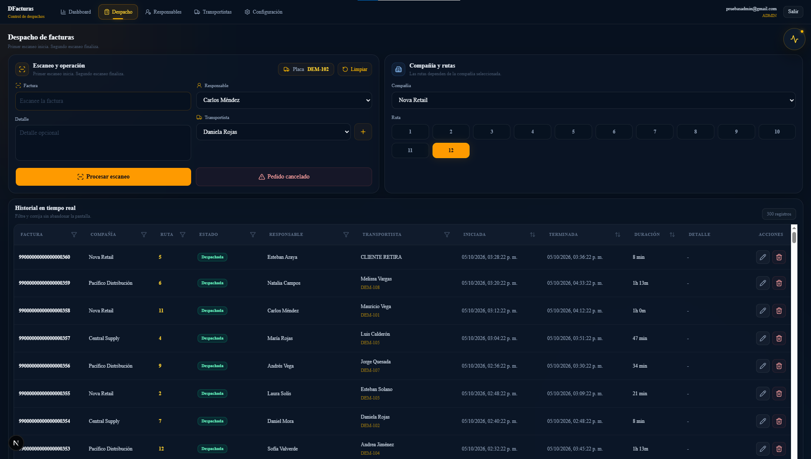
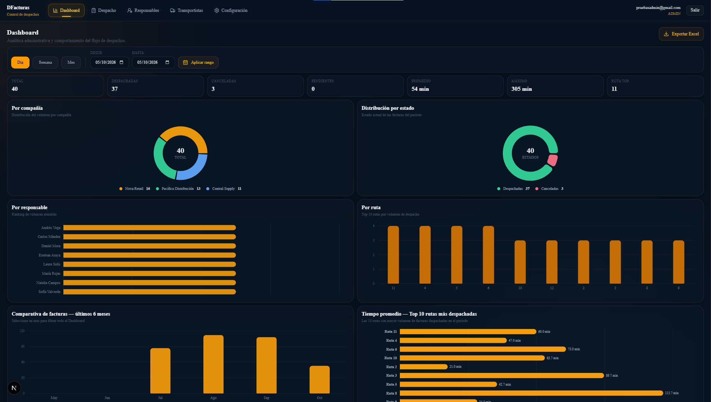
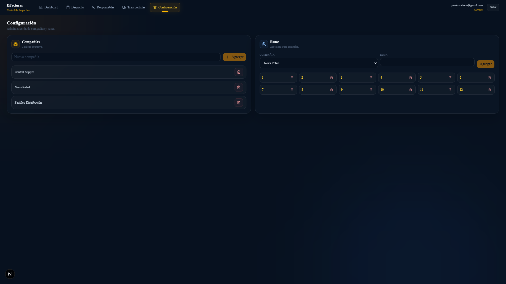
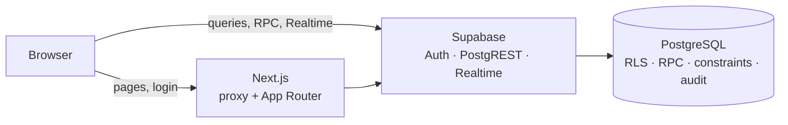

# DFacturas

Dispatch control for a distribution center. Each invoice is scanned once when its order starts being prepared and again when it leaves; operators work from a scanner-friendly screen with a live history, and administrators get catalogs, analytics, Excel export and an audit trail.

Built with Next.js, TypeScript and Supabase. PostgreSQL enforces every permission and business rule, so the browser is never trusted.

## Screenshots



| Dashboard                                                                             | Configuration                                                               |
| ------------------------------------------------------------------------------------- | --------------------------------------------------------------------------- |
|  |  |

- **Dispatch:** scan form with responsible person, carrier and plate, company and route, and the live history of the latest dispatches.
- **Dashboard:** KPIs, distribution by company and status, ranking by responsible person, routes and average time, six-month comparison, cross-filters and Excel export.
- **Configuration:** companies and their numbered routes.

## Features

- **Two-scan flow:** the first scan of a 20-digit invoice starts a dispatch (`ATENDIENDO`), the second closes it (`DESPACHADA`); further scans are blocked with an explanation.
- **Cancelled orders** with a mandatory reason; a cancelled invoice cannot be dispatched.
- **Live history** of the latest 300 dispatches, updated in real time for every user.
- **Corrections and soft deletion** with role-based limits, author and reason.
- **`CLIENTE RETIRA`** (customer pickup) as a carrier that never has a plate, enforced by the database.
- **Dashboard and Excel export** for administrators; exports are limited to a year and recorded.
- **Catalogs:** responsible staff, carriers and plates, companies and routes.
- **Audit log** of changes to sensitive tables.
- **Two roles**, `ADMIN` and `OPERATIVO`; accounts are managed from the terminal, with no public sign-up.

The full list, with business rules, is in [docs/requirements.md](docs/requirements.md).

## Tech stack

| Layer         | Technology                                                                             |
| ------------- | -------------------------------------------------------------------------------------- |
| Framework     | Next.js 16.4 (App Router), React 19.2                                                  |
| Language      | TypeScript 5.9 (strict)                                                                |
| UI            | Tailwind CSS 4, Base UI / shadcn primitives, Lucide, Recharts                          |
| Validation    | Zod 4                                                                                  |
| Data and auth | Supabase (Auth, PostgREST, Realtime) on PostgreSQL 17                                  |
| Testing       | Vitest (unit and integration), Playwright with axe-core (end to end and accessibility) |
| Tooling       | Supabase CLI, ESLint, Prettier, GitHub Actions, Dependabot                             |

## Architecture



- Pages are guarded on the server; the interactive screens query Supabase directly with the user's session.
- Every table has row-level security, and dispatch changes go only through `SECURITY DEFINER` functions that check the session, role and current state. Invoice uniqueness, route/company and carrier/plate consistency, and state timestamps are database constraints.
- Concurrent scans of one invoice are serialized with an advisory lock.
- Each response carries a nonce-based Content Security Policy, and sessions are bounded and revoked on sign-out.

Details are in [docs/architecture.md](docs/architecture.md) and [docs/database.md](docs/database.md).

## Project structure

```text
src/
├─ app/              routes, layouts, login server actions
├─ features/         dispatch, dashboard, configuration, responsables, transportistas
├─ components/       UI primitives and application shell
├─ domain/           pure rules (invoice format, scan decision, roles)
├─ services/         use cases and access guards
├─ repositories/     Supabase queries and RPC calls
├─ schemas/          Zod input validation
├─ lib/              Supabase clients, CSP, security events, safe errors
└─ proxy.ts          session refresh, CSP nonce, redirects
supabase/
├─ migrations/       forward-only schema history
├─ tests/            SQL verifiers
└─ config.toml       local stack (ports 553xx)
scripts/             env:local, users, demo:setup, db:verify
tests/integration/   tests against the database
e2e/                 Playwright end-to-end and accessibility tests
docs/                requirements, architecture, decisions, security, testing
```

## Prerequisites

- Node.js 22.18 or later (`.nvmrc` pins 22.23.3)
- npm 10
- Docker (for the local Supabase stack)

## Getting started

```bash
git clone https://github.com/Aaron23486/dfacturas.git
cd dfacturas
npm ci
npm run db:up        # local Supabase: applies all migrations to an empty database
npm run env:local    # writes .env.local with the local URL and publishable key
npm run demo:setup   # demo accounts (passwords shown once) and fictional data
npm run dev          # http://localhost:3000
```

The first `db:up` downloads the Supabase images and can take several minutes.

## Environment configuration

The web app needs only public values, written by `npm run env:local`:

| Variable                               | Purpose                                             |
| -------------------------------------- | --------------------------------------------------- |
| `NEXT_PUBLIC_SUPABASE_URL`             | Supabase API URL (`http://127.0.0.1:55321` locally) |
| `NEXT_PUBLIC_SUPABASE_PUBLISHABLE_KEY` | Publishable key of that project                     |

`.env.example` documents them. The secret key is never stored in the project: terminal scripts read it from `supabase status` or, for a hosted project, from `SUPABASE_URL`, `SUPABASE_PUBLISHABLE_KEY` and `SUPABASE_SECRET_KEY` in the shell.

## Database setup

Each evaluator runs their own database. `npm run db:up` starts PostgreSQL, Auth, PostgREST and Realtime in Docker on ports 55321–55327 and applies `supabase/migrations` in order.

| Command                     | Purpose                                                        |
| --------------------------- | -------------------------------------------------------------- |
| `npm run db:up` / `db:down` | Start or stop the local stack                                  |
| `npm run db:status`         | URLs and keys of the local stack                               |
| `npm run db:reset`          | Recreate the database from the migrations (deletes local data) |
| `npm run db:verify`         | Run the SQL verifiers in `supabase/tests`                      |

Studio is available at http://127.0.0.1:55323. To use a hosted project instead, see [docs/deployment.md](docs/deployment.md).

## Authentication and demo access

There is no public sign-up: accounts are created from the terminal, and new Auth identities start inactive.

```bash
npm run demo:setup
```

It creates or refreshes two accounts and prints their generated passwords once:

| Role        | Email                           | Can                                                              |
| ----------- | ------------------------------- | ---------------------------------------------------------------- |
| `ADMIN`     | `admin@demo.dfacturas.test`     | Everything, including dashboard, export, configuration and audit |
| `OPERATIVO` | `operativo@demo.dfacturas.test` | Scan, cancel, correct in-progress dispatches, add carriers       |

On an empty database it also creates three companies with routes, eight responsible staff, nine carriers and about 240 dispatches over the last five months (invoices starting with `99`). Run it again to get new passwords. It refuses to run against a hosted project.

Account management:

```bash
npm run create-admin                              # first administrator (prompts for email and password)
npm run users -- list
npm run users -- create --role OPERATIVO --name "Nombre Apellido"
npm run users -- deactivate <email>               # activate, set-role --role ADMIN, reset-password
```

Passwords are prompted, never passed as arguments, and need at least 12 characters with letters and digits. The database refuses to deactivate or demote the last active administrator.

## Running locally

```bash
npm run dev                      # development server on :3000
npm run build && npm run start   # production build
```

Sign in at http://localhost:3000/login. To try the flow, select a responsible person, carrier, company and route, then type or scan a 20-digit invoice (for example `99000000000000009999`) twice.

## Testing and quality checks

| Command                                                     | What it runs                                                                   |
| ----------------------------------------------------------- | ------------------------------------------------------------------------------ |
| `npm run format:check`, `npm run lint`, `npm run typecheck` | Prettier, ESLint, TypeScript                                                   |
| `npm run test:coverage`                                     | Unit tests; fails below 85% coverage of the logic modules                      |
| `npm run test:integration`                                  | Permissions, rules, concurrency and Realtime against the local database        |
| `npm run test:e2e`                                          | Playwright on a production build (port 3100), including axe WCAG 2.1 AA checks |

Integration and end-to-end tests need `npm run db:up`; the first end-to-end run needs `npx playwright install chromium`. They create and remove their own accounts and data. CI runs all of them on every pull request. See [docs/testing.md](docs/testing.md).

## Security

- Authorization in PostgreSQL: row-level security on every table, writes through validated RPCs, internal helpers closed to clients.
- Bounded sessions (12 hours, 4 hours idle), revoked in the database as soon as the user signs out.
- Per-request nonce CSP without inline scripts, HSTS and hardening headers.
- Safe error messages, audit log, recorded and bounded exports, and security events without personal data.
- Dependency audit and secret scanning in CI.

Controls, how they are tested and the remaining risks are in [docs/security.md](docs/security.md). Please report vulnerabilities as described in [SECURITY.md](SECURITY.md).

## Engineering decisions

- **The database is the security boundary.** I kept the rules in SQL so that no client, including a modified one, can skip them, and tested them against a real database instead of mocks ([ADR 0001](docs/decisions/0001-database-as-authorization-boundary.md)).
- **Browser Supabase client, bounded cookie.** Moving every query and the live feed to the server would have rewritten most of the UI; instead I shortened the session, revoke it in the database and rely on a strict CSP ([ADR 0002](docs/decisions/0002-browser-client-and-readable-session-cookie.md), [ADR 0004](docs/decisions/0004-per-request-nonce-csp.md), [ADR 0005](docs/decisions/0005-live-session-check.md)).
- **Local stack and terminal accounts.** Anyone can run the project with Docker and one command per step, without access to my Supabase project ([ADR 0003](docs/decisions/0003-local-supabase-and-terminal-accounts.md)).
- **Traceable exports.** Data that leaves the system is limited and recorded ([ADR 0006](docs/decisions/0006-audited-bounded-exports.md)).

## Known limitations

- The session cookie is readable by JavaScript because the browser talks to Supabase directly; the CSP and short sessions limit the impact.
- Login throttling relies on Supabase Auth's per-IP limits.
- Password recovery is a terminal task; there is no "forgot password" screen.
- The history shows the latest 300 dispatches; older ones are reached through the dashboard and export.
- Dates in the dashboard and export use the America/Costa_Rica time zone.
- The UI is in Spanish.

## License

[MIT](LICENSE)
