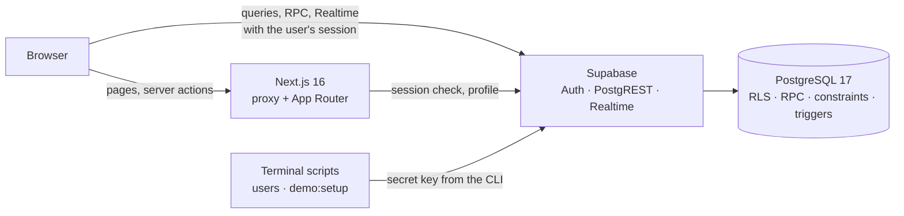
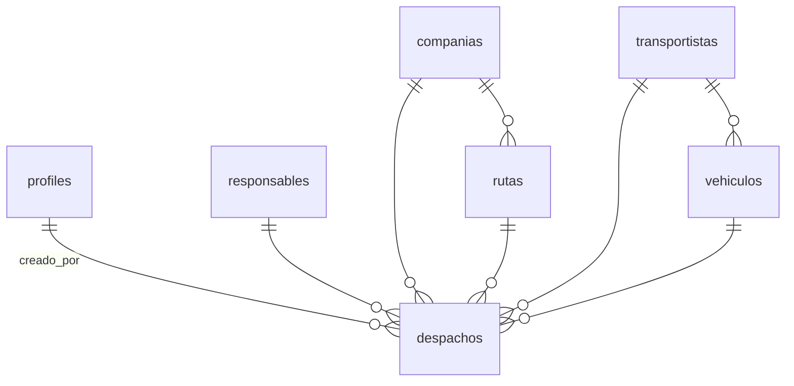

# Architecture

## Principles

- **The database decides.** Authorization and business rules live in PostgreSQL; the UI mirrors them for usability only (D-1).
- **Thin layers with a job each.** Routes compose pages, features render, services orchestrate, repositories talk to Supabase, domain modules hold pure rules. No layer exists without a responsibility.
- **Reproducible by default.** The same local Supabase stack serves development, tests and CI (D-3).
- **Secure by default in the browser.** Strict CSP, bounded sessions and safe error messages (D-2, D-4, D-5).

## System overview

Next.js renders pages, runs the login and logout server actions and guards routes. The interactive screens query Supabase directly from the browser with the signed-in user's session; PostgreSQL applies RLS and the RPCs validate every change. Terminal scripts are the only holders of the secret key.

## Request paths

1. **Page request.** `src/proxy.ts` creates a CSP nonce, refreshes the Supabase session and redirects to `/login` without a user. The page calls `requireProfile()` or `requireAdmin()` (`src/services/auth.service.ts`), which read the profile with the user's session.
2. **Scan.** `DispatchWorkspace` validates the invoice with the domain rules, `processFacturaScan` (`src/services/scan.service.ts`) reads the current dispatch and calls `scan_dispatch`. The RPC locks the invoice (`pg_advisory_xact_lock`), checks the session, profile and context, and inserts or closes the dispatch.
3. **Live history.** The workspace subscribes to `postgres_changes` on `despachos`; RLS decides which rows each subscriber receives.
4. **Export.** The dashboard calls `admin_dashboard_export_rows`, which checks the role and period, records the export and returns rows; the browser builds the workbook.

## Code structure

| Path                                      | Responsibility                                                                                                                      |
| ----------------------------------------- | ----------------------------------------------------------------------------------------------------------------------------------- |
| `src/app`                                 | Routes, layouts and the login server actions. Pages guard access and compose features.                                              |
| `src/features/*/components`               | Feature UI: dispatch workspace, history table and dialogs; dashboard and Excel export; configuration; responsables; transportistas. |
| `src/components/ui`, `src/components/app` | Reusable primitives (shadcn/Base UI) and application composites (shell, navigation, dialog, status badge).                          |
| `src/domain`                              | Pure rules without React or Supabase: invoice format (R-1), scan decision (FR-3, FR-4), roles.                                      |
| `src/services`                            | Use-case orchestration and access guards.                                                                                           |
| `src/repositories`                        | Supabase queries and RPC calls, mapping rows to application types and errors to safe messages.                                      |
| `src/schemas`                             | Zod validation of untrusted input before it reaches a repository.                                                                   |
| `src/lib`                                 | Supabase clients and cookie options, CSP, security events, safe errors, utilities.                                                  |
| `supabase/migrations`                     | Forward-only schema history (see [database.md](database.md)).                                                                       |
| `scripts`                                 | Terminal tools: `env:local`, `users`, `demo:setup`, `db:verify`.                                                                    |
| `tests/integration`, `e2e`                | Tests against the database and in the browser (see [testing.md](testing.md)).                                                       |

Components follow an Atomic Design progression (primitives → application composites → feature compositions → pages) without literal `atoms/` or `molecules/` folders.

## Data model

`audit_logs` receives a row for every insert, update or delete on the business tables, and `dashboard_exports` one per export. Details, constraints and helpers are in [database.md](database.md).

## Access matrix

| Area                                           | OPERATIVO   | ADMIN              | Enforced by                                  |
| ---------------------------------------------- | ----------- | ------------------ | -------------------------------------------- |
| Scan, cancel                                   | Yes         | Yes                | `scan_dispatch`, `cancel_dispatch`           |
| Correct in-progress dispatch                   | Yes         | Yes                | `compat_update_dispatch`                     |
| Correct or soft-delete a closed dispatch       | Detail only | Yes                | `compat_*` RPC role checks (R-10)            |
| See soft-deleted dispatches                    | No          | Yes                | RLS `despachos_select`                       |
| Read catalogs                                  | Yes         | Yes                | RLS                                          |
| Add carrier with plate                         | Yes         | Yes                | `compat_create_transportista_with_plate`     |
| Edit carriers, responsables, companies, routes | No          | Yes                | RLS policies and `compat_*` RPCs             |
| Dashboard and export                           | No          | Yes                | `requireAdmin`, `admin_dashboard_*`          |
| Audit log, export log                          | No          | Yes                | `requireAdmin`, RLS                          |
| Accounts and roles                             | No          | No (terminal only) | Service role, `keep_an_active_admin` trigger |

## Decisions

| ID  | Decision                                                                         | Record                                                                   |
| --- | -------------------------------------------------------------------------------- | ------------------------------------------------------------------------ |
| D-1 | PostgreSQL (RLS, RPC, constraints) is the authorization boundary.                | [ADR 0001](decisions/0001-database-as-authorization-boundary.md)         |
| D-2 | Keep the browser Supabase client and bound its readable session cookie.          | [ADR 0002](decisions/0002-browser-client-and-readable-session-cookie.md) |
| D-3 | Local Supabase stack for development and CI; accounts managed from the terminal. | [ADR 0003](decisions/0003-local-supabase-and-terminal-accounts.md)       |
| D-4 | Per-request nonce CSP with `'strict-dynamic'`.                                   | [ADR 0004](decisions/0004-per-request-nonce-csp.md)                      |
| D-5 | Authorization helpers require a live Auth session.                               | [ADR 0005](decisions/0005-live-session-check.md)                         |
| D-6 | Exports are bounded to a year and recorded.                                      | [ADR 0006](decisions/0006-audited-bounded-exports.md)                    |

## Stack

| Layer         | Technology                                                        |
| ------------- | ----------------------------------------------------------------- |
| Framework     | Next.js 16.4 (App Router, proxy), React 19.2                      |
| Language      | TypeScript 5.9 (strict)                                           |
| UI            | Tailwind CSS 4, Base UI / shadcn primitives, Lucide, Recharts     |
| Validation    | Zod 4                                                             |
| Data and auth | Supabase (Auth, PostgREST, Realtime), PostgreSQL 17               |
| Tooling       | Supabase CLI, Vitest 5, Playwright + axe-core, ESLint 9, Prettier |
