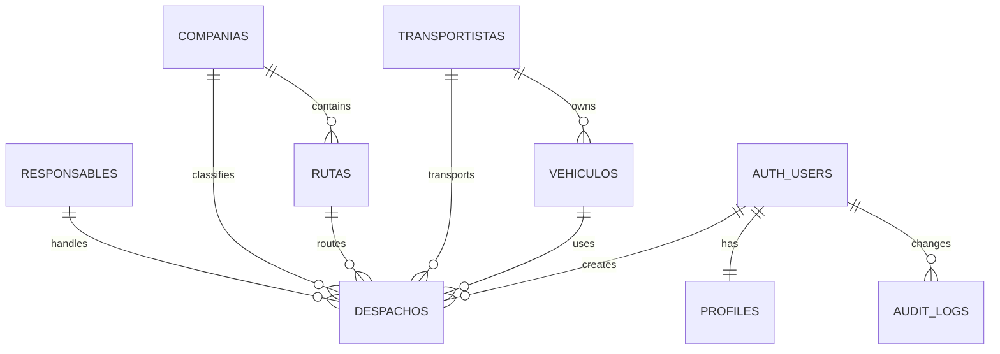
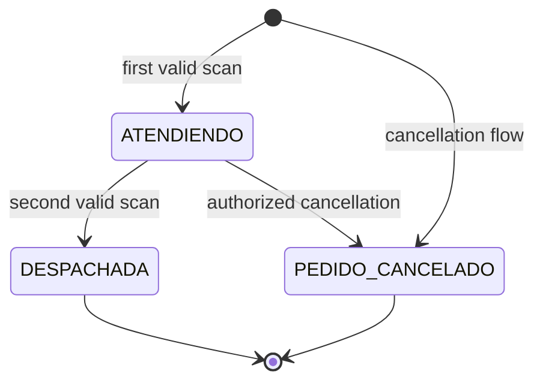

# Database

## Overview

DFacturas uses PostgreSQL through Supabase. The database is not a passive storage layer: it enforces dispatch state, relational integrity, authorization and auditability.

## Core entities

### Tables

| Table               | Purpose                                                                     |
| ------------------- | --------------------------------------------------------------------------- |
| `profiles`          | application role and active state for an Auth user                          |
| `responsables`      | personnel responsible for dispatch preparation                              |
| `companias`         | company/client catalog                                                      |
| `rutas`             | routes associated with a company                                            |
| `transportistas`    | carrier catalog, including the special `CLIENTE RETIRA` flag                |
| `vehiculos`         | vehicles/plates associated with a carrier                                   |
| `despachos`         | operational invoice dispatch state and timestamps                           |
| `audit_logs`        | immutable-style record of sensitive row changes from database triggers      |
| `dashboard_exports` | append-only record of every Excel export (who, when, period, filters, rows) |

## Enums

### `app_role`

- `ADMIN`
- `OPERATIVO`

### `dispatch_status`

- `ATENDIENDO`
- `DESPACHADA`
- `PEDIDO_CANCELADO`

## Dispatch invariants

The baseline schema and later hardening migrations enforce rules such as:

- `factura` must match exactly 20 numeric digits.
- only one non-soft-deleted dispatch may exist for an invoice.
- a route cannot exist on a dispatch without a company.
- `(ruta_id, compania_id)` must be a valid route/company pair.
- a vehicle cannot exist on a dispatch without a carrier.
- `(vehiculo_id, transportista_id)` must be a valid vehicle/carrier pair.
- `ATENDIENDO` requires a start timestamp and no final/cancel timestamp.
- `DESPACHADA` requires start + final timestamps and no cancel timestamp.
- `PEDIDO_CANCELADO` requires a cancel timestamp and a non-empty reason.
- soft delete requires `deleted_at`, `deleted_by` and a non-empty `delete_reason` together.
- dispatch detail/delete-reason fields are capped at 1000 characters after security hardening.

## State machine

A terminal state cannot be silently converted by a normal scan. Corrections/deletions use explicit privileged RPCs with validation.

## Special carrier: `CLIENTE RETIRA`

`transportistas.es_cliente_retira` is a boolean domain flag. A partial unique index ensures only one carrier can hold the special flag. Database validation prevents a `CLIENTE RETIRA` dispatch from being associated with a vehicle.

This avoids coupling a business invariant to a UI label string.

## Migration history

Migrations are applied in order by `npm run db:up` / `npm run db:reset` (local) or `supabase db push` (hosted). All of them apply to an empty database; CI checks this on every change.

The repository currently contains five applied forward-only migrations:

| Version                                                  | Purpose                                                                                                                                            |
| -------------------------------------------------------- | -------------------------------------------------------------------------------------------------------------------------------------------------- |
| `20260930000001_initial_schema.sql`                      | relational baseline, enums, constraints, indexes and validation triggers                                                                           |
| `20260930000002_security_audit.sql`                      | profiles, auth helpers, RLS, grants and audit logging                                                                                              |
| `20260930000003_dispatch_rpcs.sql`                       | transactional dispatch RPCs                                                                                                                        |
| `20261002000004_original_ui_compatibility.sql`           | compatibility/admin RPCs and dashboard analytics/export functions                                                                                  |
| `20261004000005_security_hardening.sql`                  | least-privilege hardening, inactive-by-default users, soft-delete visibility, text limits and stricter RPC validation                              |
| `20261029000006_realtime_dispatch_feed.sql`              | adds `despachos` to the `supabase_realtime` publication so the live history receives events                                                        |
| `20261029000007_keep_an_active_admin.sql`                | trigger that rejects demoting, deactivating or deleting the last active `ADMIN`                                                                    |
| `20261029000008_require_live_session.sql`                | `has_live_session()`; `is_active_user()` and `current_user_role()` require the token's Auth session to exist                                       |
| `20261029000009_audit_and_limit_exports.sql`             | `dashboard_exports`; export limited to 366 days and recorded; query moved to an internal function                                                  |
| `20261029000010_password_changes_only_from_terminal.sql` | trigger on `auth.users` that only accepts password changes from `terminal_set_password()` (service role), which also closes the account's sessions |

### Rule: migrations are immutable after application

Do not edit, reorder or “repair” a migration once it is on `main`. Every schema change is a new migration with a later version.

## Authorization helpers

The database defines helpers including:

- `current_user_role()`
- `is_admin()`
- `is_operativo()`
- `is_active_user()`
- `require_active_user()`
- `has_live_session()`

These centralize role and active-profile checks used by RLS policies and RPCs. Since migration 008 the active-user and role helpers also require the JWT's `session_id` to exist in `auth.sessions`, so signing out cuts database access at once.

## Dispatch RPCs

Security-sensitive operations include:

- `scan_dispatch(...)`
- `cancel_dispatch(...)`
- `admin_update_dispatch(...)`
- `admin_soft_delete_dispatch(...)`

Compatibility/admin functions support UI parity while preserving database authorization, such as carrier/vehicle operations, route management and dashboard data retrieval.

## Concurrency control

`scan_dispatch` and `cancel_dispatch` take a transaction-level advisory lock on the invoice (`pg_advisory_xact_lock`) and then lock the current row (`FOR UPDATE`) before deciding. Five simultaneous scans of a new invoice end with one `DESPACHADA` row (integration test). Profile changes that could remove the last administrator are serialized with their own advisory lock.

## RLS and direct privileges

All application tables have RLS enabled. Table grants and function execution privileges are separately constrained. In particular, migration `005` removes direct authenticated insert/update privileges for `transportistas` and `vehiculos`, forcing those mutation paths through validated RPCs.

Soft-deleted dispatch rows are not visible to ordinary active operational users; admins retain access for administrative/audit purposes.

## Audit trail

Database triggers write sensitive row changes to `audit_logs` with:

- table name;
- record ID;
- action (`INSERT`, `UPDATE`, `DELETE`);
- old/new JSON snapshots when applicable;
- authenticated user ID when available;
- timestamp.

`audit_logs` is readable only by `ADMIN` through RLS and is not directly writable by browser clients.

`dashboard_exports` records each Excel export. Only administrators can read it, and a trigger rejects updates and deletes, also for the service role. Neither log has a foreign key to the acting user, so records outlive deleted accounts.

## Seed/data policy

No real data belongs in the repository and there is no SQL seed. `npm run demo:setup` creates fictional companies, routes, responsible staff, carriers and about 240 dispatches over five months on a local database only; invoices start with `99`. Integration tests use the prefix `77` and end-to-end tests `88`, and both remove their data.
