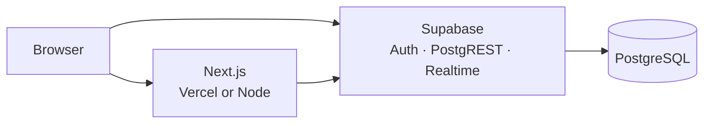

# Deployment (optional)

The application is meant to be evaluated locally (see the [README](../README.md)). This guide covers running it on a hosted Supabase project with the Next.js app on Vercel or any Node host.



## 1. Quality gate

From a clean checkout of the commit to deploy, CI must be green (`checks`, `supply-chain`, `integration`). Locally the equivalent is:

```bash
npm ci
npm run format:check && npm run lint && npm run typecheck
npm run test:coverage && npm run build
npm run db:up && npm run db:verify && npm run test:integration && npm run test:e2e
```

## 2. Supabase project

1. Create a dedicated project; never reuse a database with unrelated real data.
2. Link and apply the migrations with the Supabase CLI:

   ```bash
   npx supabase link --project-ref <your-project-ref>
   npx supabase db push --dry-run
   npx supabase db push
   ```

3. Run the verifier in the SQL editor: `supabase/tests/20261004000005_security_hardening_verify.sql` (it raises `VERIFY_FAILED` if a control is missing).

## 3. Auth settings

`supabase/config.toml` applies these locally; on a hosted project set them in the dashboard:

| Setting                                     | Value                                                                            |
| ------------------------------------------- | -------------------------------------------------------------------------------- |
| Email provider                              | Enabled; **Allow new users to sign up: off**                                     |
| Anonymous sign-ins, manual linking          | Off                                                                              |
| Minimum password length                     | 10 or more                                                                       |
| Secure password change                      | On                                                                               |
| Sessions: time-box / inactivity timeout     | 12 h / 4 h (plan-dependent)                                                      |
| Site URL, redirect URLs                     | The deployed origin only                                                         |
| Rate limits                                 | Keep defaults or lower; consider CAPTCHA if the login is public                  |
| Email templates for recovery and magic link | Not used by the app: customize them without links, or keep email rate limits low |
| `pg_graphql`                                | Disable if unused                                                                |

## 4. Application

Set only the public values:

```env
NEXT_PUBLIC_SUPABASE_URL=https://<your-project-ref>.supabase.co
NEXT_PUBLIC_SUPABASE_PUBLISHABLE_KEY=<publishable key>
```

The secret key never goes into the app's environment. Build with `npm run build` and start with `npm run start`; serve over HTTPS (the app sends HSTS in production).

## 5. First administrator

From a terminal with the project's keys in the environment (not in `.env.local`):

```bash
SUPABASE_URL=... SUPABASE_PUBLISHABLE_KEY=... SUPABASE_SECRET_KEY=... npm run create-admin
```

Then create operators with `npm run users -- create`. `demo:setup` refuses to run against a hosted project.

## 6. Smoke test

- An unauthenticated visit to `/app` redirects to `/login`; wrong credentials show a generic message.
- An operator can scan an invoice twice (`Atendiendo` → `Despachada`) and is redirected away from `/admin/*`.
- An administrator sees the dashboard, exports a month and finds the export in `dashboard_exports`.
- Response headers include the nonce CSP and HSTS.

## 7. Rollback

Migrations are forward-only. Roll back the application to the previous release; if a migration must be undone, write a new migration that reverses it after testing it on a copy of the data.
